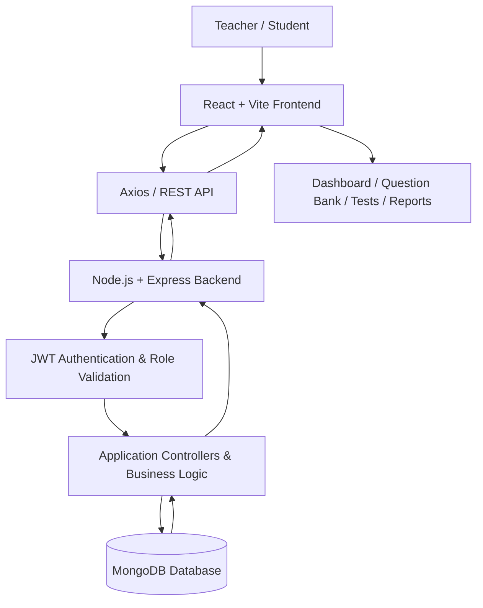
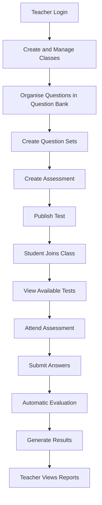

# MarkOne – Smart Assessment Platform

**A Full-Stack Teacher–Student Assessment Platform**

MarkOne is a web-based assessment platform designed to simplify classroom test management, question organisation, online assessments, automated evaluation, and student performance analysis.

Built with React, Node.js, Express, and MongoDB, MarkOne provides teachers with tools to manage classes, organise questions, create assessments, and track student performance through detailed reports.

Students can join their respective classes using their official student details and attend assessments through a dedicated testing interface.

---

## Table of Contents

- [Overview](#overview)
- [Features](#features)
- [Technology Stack](#technology-stack)
- [System Architecture](#system-architecture)
- [Assessment Workflow](#assessment-workflow)
- [Database Structure](#database-structure)
- [Project Structure](#project-structure)
- [Local Installation](#local-installation)
- [Environment Variables](#environment-variables)
- [API Overview](#api-overview)
- [Security](#security)
- [Deployment](#deployment)
- [Future Enhancements](#future-enhancements)
- [Author](#author)

---

## Overview

MarkOne provides a centralised platform for managing the complete assessment process.

The application has two primary user roles:

**Teachers**
- Manage classes and student enrolments.
- Create and organise questions.
- Maintain question sets.
- Prepare and publish assessments.
- Monitor student performance.
- Generate class reports and analyse assessment results.

**Students**
- Join classes using official student details.
- View available assessments.
- Attend online tests.
- Track completed assessments.
- Review answers and performance.

The platform is designed to reduce manual assessment work and make the testing process more organised and accessible.

---

## Features

### 1. Teacher Module

- Teacher login and authentication.
- Teacher-specific dashboard.
- Class creation and management.
- Unique class codes with duplicate-code validation.
- View and manage enrolled students.
- Class-wise assessment management.
- Teacher-specific data isolation.
- Dashboard statistics and student-count tracking.

The backend also contains teacher registration and mobile OTP verification endpoints. However, production SMS delivery is not yet connected.

### 2. Student Module

MarkOne uses an official student roster for student identification.

- Class selection.
- Register number selection based on the selected class.
- Automatic retrieval of the student's official name.
- Read-only student name field.
- Class-code-based joining.
- Backend validation of student identity.
- JWT-based student authentication.
- Student-specific dashboard.

**Current official roster:** 12A1 and 12A2.

Student names are retrieved from the stored official student records rather than being accepted as arbitrary names entered by the student.

Development-only test accounts are separately restricted and are not intended for production student access.

### 3. Question Bank

The Question Bank provides a centralised workspace for teachers to create and organise assessment questions.

**Question management**
- Create questions manually.
- Edit existing questions.
- Delete individual or multiple questions.
- Search questions.
- Filter questions.
- Duplicate detection for manually created or edited questions.

**Paste Questions**
- Paste question content into the import interface.
- Parse supported pasted question formats into structured question records.
- Extract question text, options and answers.
- Store imported questions in the selected question set.
- Support importing questions into Ungrouped Questions when that section is selected.

**Question Sets**
- Create question sets.
- Rename existing question sets.
- Organise questions by unit or topic.
- View question counts.
- Assign ungrouped questions to a question set.
- Delete question sets without deleting their questions.

**Supported question types**
- Multiple Choice Questions (MCQ).
- True or False.
- Fill in the Blanks.
- Assertion and Reason.

The Question Bank uses pagination to manage large collections of questions.

### 4. Test Creation and Management

Teachers can create assessments using questions from their Question Bank.

Available configuration includes:

- Assessment title.
- Subject and class selection.
- Question set selection.
- Question selection.
- Test duration.
- Negative marking configuration.
- Question shuffling.
- Option shuffling.
- Scheduled availability.
- Automatic submission settings.
- Answer visibility after submission.
- Retest permissions.
- Draft and published test status.

The backend validates that selected questions belong to the chosen question set before creating the assessment.

### 5. Student Test Experience

Students receive a dedicated interface for attending assessments.

Features include:

- View available tests.
- Start assigned assessments.
- Countdown timer.
- Question navigation.
- Question palette.
- Mark questions for review.
- Select answers.
- Track answered and unanswered questions.
- Submit assessments.
- Automatic submission when the timer expires, if enabled.

The application records submitted answers and the time spent on individual questions.

### 6. Automated Evaluation and Results

After submission, the backend evaluates the student's answers and calculates assessment performance.

Results include:

- Total marks.
- Score.
- Percentage.
- Correct answers.
- Incorrect answers.
- Skipped questions.
- Chapter-wise performance.
- Strong chapters.
- Chapters requiring revision.

Students can also review their submitted answers, compare them with correct answers, and view available explanations.

A downloadable PDF revision report is available for completed assessments.

### 7. Teacher Reports and Analytics

The Reports module helps teachers understand class-wide and individual student performance.

Available features include:

- Class-wise reports.
- Student-wise performance.
- Assessment-wise filtering.
- Class average.
- Total attempts.
- Attempted student count.
- Question-wise analysis.
- Wrong-answer analysis.
- Strong and weak chapter analysis.
- Excel report export.
- PDF report export.

Reports are generated from stored assessment attempts and student records.

---

## Technology Stack

| Layer | Technologies |
|---|---|
| Frontend | React 18, Vite |
| Styling | Tailwind CSS |
| Routing | React Router |
| API Communication | Axios |
| Animations | Framer Motion |
| Charts | Chart.js, React Chart.js 2 |
| Backend | Node.js, Express.js |
| Database | MongoDB, Mongoose |
| Authentication | JSON Web Tokens (JWT) |
| Password Hashing | bcryptjs |
| Excel Reports | ExcelJS |
| PDF Generation | PDFKit |
| Validation | Express Validator |
| Security | Helmet, CORS, Express Rate Limit |
| Deployment | Vercel, Render |

---

## System Architecture

MarkOne follows a three-layer full-stack architecture.



### Architecture Components

**1. Frontend – React**

The frontend handles the user interface and interactions.

It includes:
- Teacher dashboard.
- Student login.
- Question Bank.
- Test creation.
- Student test interface.
- Results and reports.

**2. Backend – Node.js and Express**

The backend handles:
- REST API endpoints.
- Authentication and authorisation.
- Request validation.
- Class management.
- Student validation.
- Question management.
- Test creation and submission.
- Result evaluation.
- Report generation.

**3. Database – MongoDB**

MongoDB stores application data, including teacher accounts, student records, classes, questions, question sets, tests, and test attempts.

**4. Authentication**

JWT tokens are used to authenticate users. Protected backend routes check the user's role and permissions before processing requests.

---

## Assessment Workflow



---

## Database Structure

MarkOne uses MongoDB with Mongoose models.

The main database models include:

| Model | Purpose |
|---|---|
| Teacher | Stores teacher account information and authentication details. |
| Student | Stores official student records, class association and student identity information. |
| Class | Stores class details, subject, class code and teacher association. |
| Question | Stores questions, options, answers, explanations and question-set association. |
| QuestionSet | Stores teacher-specific question set titles. |
| Test | Stores assessment configuration, selected questions and publishing status. |
| TestAttempt | Stores student answers, marks, percentages and submission information. |
| SystemSetting | Stores system-level settings used by application workflows. |

### Important Relationships

- A teacher can manage multiple classes.
- A teacher can create multiple question sets.
- Questions belong to a teacher and can optionally belong to a question set.
- A test belongs to a teacher and a class.
- A test contains selected questions.
- A student can submit assessment attempts.
- Test attempts are associated with both the student and the test.

---

## Project Structure

The repository contains separate frontend and backend applications.

```text
MarkOne/
│
├── frontend/
│   ├── public/
│   ├── src/
│   │   ├── api/
│   │   ├── components/
│   │   ├── context/
│   │   └── pages/
│   │       ├── LandingPage.jsx
│   │       ├── TeacherLogin.jsx
│   │       ├── StudentJoin.jsx
│   │       ├── TeacherDashboard.jsx
│   │       ├── QuestionBank.jsx
│   │       ├── CreateTest.jsx
│   │       ├── TeacherReports.jsx
│   │       ├── StudentDashboard.jsx
│   │       ├── TestInterface.jsx
│   │       └── ResultPage.jsx
│   ├── package.json
│   ├── vite.config.js
│   └── .env.example
│
├── backend/
│   ├── config/
│   ├── controllers/
│   ├── middleware/
│   ├── models/
│   ├── routes/
│   ├── scripts/
│   ├── services/
│   ├── utils/
│   ├── assets/
│   ├── server.js
│   └── package.json
│
├── .gitignore
└── README.md
```

---

## Local Installation

### Prerequisites

- Node.js 18 or later.
- npm.
- MongoDB Atlas account or a local MongoDB instance.
- Git.

### 1. Clone the Repository

```bash
git clone https://github.com/ashu-0715/MarkOne.git

cd MarkOne
```

### 2. Backend Setup

Open a terminal:

```bash
cd backend
npm install
```

Create a `.env` file inside the `backend` directory.

Add the required environment variables:

```env
PORT=5000
NODE_ENV=development
MONGO_URI=your_mongodb_connection_string
JWT_SECRET=your_secure_jwt_secret
CLIENT_URL=http://localhost:5173
```

Start the backend:

```bash
npm run dev
```

Backend URL:

`http://127.0.0.1:5000`

Backend health-check endpoint:

`http://127.0.0.1:5000/api/health`

### 3. Frontend Setup

Open another terminal:

```bash
cd frontend
npm install
```

Create a `.env` file inside the `frontend` directory.

Add:

```env
VITE_API_URL=http://localhost:5000/api
```

Start the frontend:

```bash
npm run dev
```

Frontend URL:

`http://localhost:5173`

### 4. Available Backend Scripts

| Command | Purpose |
|---|---|
| `npm run dev` | Start backend in development mode. |
| `npm start` | Start backend in production mode. |
| `npm run seed` | Run the database seed script. |
| `npm run students:import` | Import official student records. |
| `npm run students:seed-local-test` | Seed local development test students. |

---

## Environment Variables

### Backend

| Variable | Purpose |
|---|---|
| `PORT` | Backend server port. |
| `NODE_ENV` | Application environment. |
| `MONGO_URI` | MongoDB connection string. |
| `JWT_SECRET` | Secret used for JWT signing and verification. |
| `JWT_EXPIRES_IN` | Optional JWT expiration setting. |
| `CLIENT_URL` | Frontend origin permitted by the CORS configuration. |

Additional AI, OCR and SMS provider variables are reserved for future integrations.

### Frontend

| Variable | Purpose |
|---|---|
| `VITE_API_URL` | Backend API base URL, including the `/api` prefix. |

Never commit `.env` files or expose database credentials and authentication secrets in the repository.

---

## API Overview

The backend exposes REST API endpoints under the `/api` prefix.

| Route | Purpose |
|---|---|
| `/api/health` | Backend health check. |
| `/api/auth` | Teacher authentication and student joining. |
| `/api/classes` | Class creation and management. |
| `/api/questions` | Question Bank and Question Set management. |
| `/api/tests` | Test creation, publishing, attendance and submission. |
| `/api/reports` | Teacher reports and report exports. |

Protected endpoints require the appropriate JWT authentication and user role.

---

## Security

The backend includes several security mechanisms:

- JWT-based authentication.
- Role-based access control for teachers and students.
- bcryptjs password hashing with 12 salt rounds.
- Protected API routes.
- Teacher-specific resource filtering.
- Express Validator request validation.
- Helmet security headers.
- Configured CORS origin.
- Express Rate Limit.
- MongoDB query sanitisation.
- XSS input sanitisation.
- Environment-based secret management.
- Production error responses that do not expose stack traces.

Development test accounts are restricted to local development conditions and are excluded from normal production student access.

---

## Deployment

The project uses a separate frontend and backend deployment architecture.

| Component | Platform |
|---|---|
| Frontend | Vercel |
| Backend | Render |
| Database | MongoDB Atlas |

### Frontend Deployment – Vercel

1. Import the GitHub repository into Vercel.
2. Set the project root directory to `frontend`.
3. Configure `VITE_API_URL` with the deployed backend API URL, including `/api`.
4. Deploy the frontend.

### Backend Deployment – Render

1. Connect the GitHub repository to Render.
2. Set the backend root directory to `backend`.
3. Configure the required environment variables.
4. Add the MongoDB Atlas connection string.
5. Configure `CLIENT_URL` with the deployed frontend origin.
6. Deploy the backend service.

Make sure the backend CORS configuration permits the deployed frontend origin.

---

## Future Enhancements

The following integrations are not yet fully connected and are planned for future development.

### AI-Powered Question Generation

The `backend/services/aiService.js` module provides the integration structure for:
- Generating questions from lesson content.
- Generating questions from custom prompts.
- AI-assisted diagram generation.

A real LLM provider integration is still required.

### OCR-Based Question Extraction

The `backend/services/ocrService.js` module is reserved for:
- Extracting text from PDF documents.
- Extracting text from images.
- Processing scanned question content.

An OCR provider such as Tesseract.js or a cloud OCR service still needs to be integrated.

### Additional Enhancements

- Production SMS provider for teacher OTP delivery.
- Cloud-based question image and diagram uploads.
- Expanded AI-assisted question organisation.
- Additional assessment analytics.

---

## Author

**ASWINI E**

GitHub: [ashu-0715](https://github.com/ashu-0715)

Project Repository: [MarkOne](https://github.com/ashu-0715/MarkOne)

---

**MarkOne – Making Assessments Simpler, Smarter, and More Organised.**
